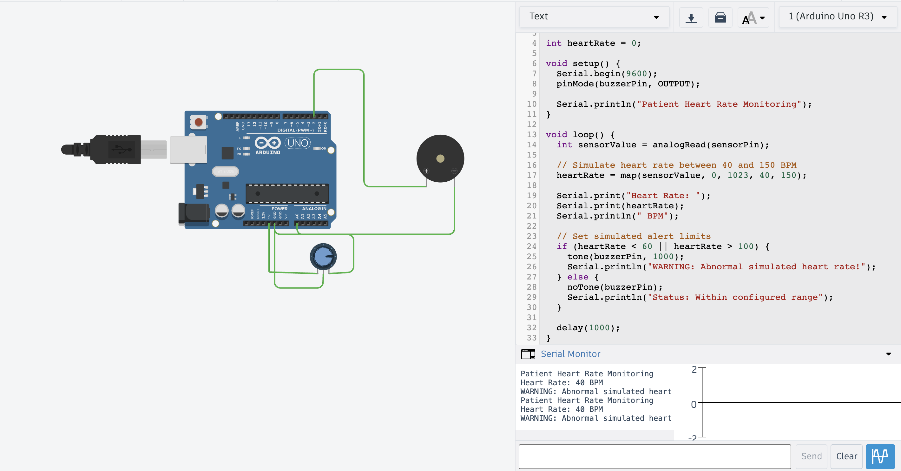
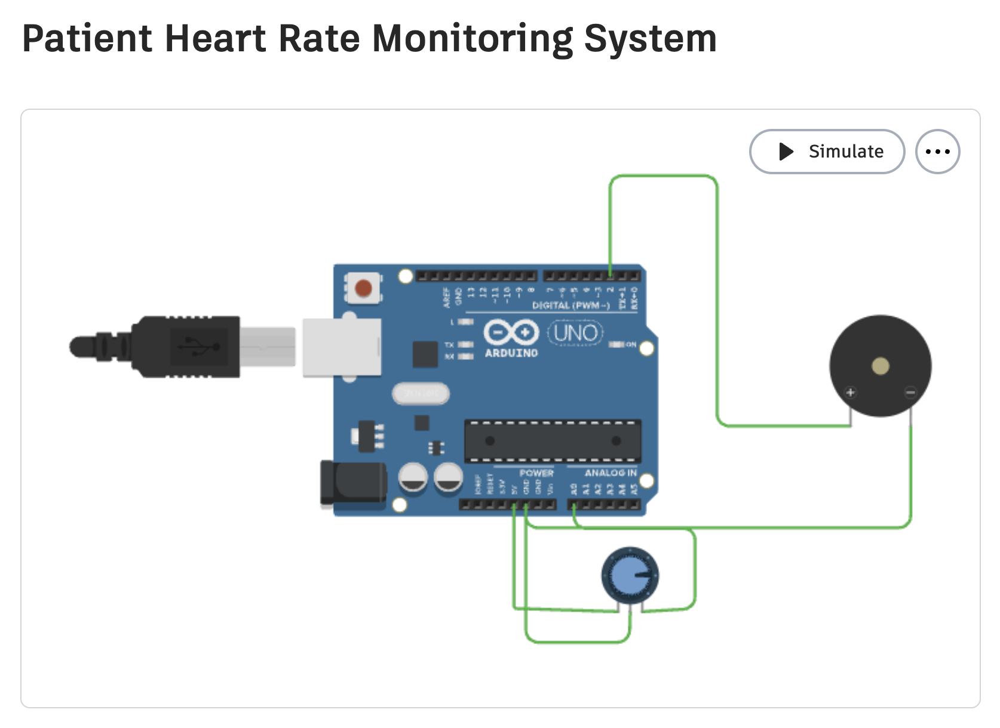

# PATIENT-HEART-RATE-MONITORING-SYSTEM
To design a system that monitors a patient's heart rate and displays the readings in BPM using a microcontroller.

### ~Objectives of Patient Heart Rate Monitoring System

1. To measure and monitor a patient's simulated heart rate in beats per minute (BPM).
2. To display the heart rate readings on the Serial Monitor.
3. To detect heart rate readings below or above the predefined limits.
4. To activate a buzzer when the simulated heart rate is abnormal.
5. To demonstrate a low-cost patient monitoring system using Arduino Uno and Tinkercad simulation.
6. To understand the application of sensors and microcontrollers in healthcare monitoring.
### ~Hardware Components:

1. Arduino Uno R3
2. 10 kΩ potentiometer
3. Piezo buzzer
4. Breadboard
5. Jumper wires
6. USB cable
### ~Working:

1. The potentiometer simulates the pulse sensor input.
2. The Arduino Uno reads the input value.
3. The input is converted into heart rate (BPM).
4. The BPM is displayed on the Serial Monitor.
5. If BPM is below 60 or above 100, the buzzer turns ON.
6. If BPM is between 60 and 100, the buzzer remains OFF.
### ~Future Scope:

1. Use a real heart rate sensor to measure pulse accurately.
2. Display BPM on an LCD or OLED screen.
3. Send heart rate data to a mobile app using Wi-Fi or Bluetooth.
4. Store patient readings in a cloud database.
5. Send emergency alerts to doctors or caregivers.
6. Extend the system to monitor blood oxygen levels (SpO₂).
### ~Applications:

1. Patient heart rate monitoring in hospitals.
2. Home healthcare monitoring.
3. Elderly patient monitoring.
4. Remote health monitoring using IoT.
5. Fitness and exercise monitoring.
6. Early warning for unusually high or low heart rate readings.
### ~Simmulation:

https://www.tinkercad.com/things/emCzpSfzMcO-patient-heart-rate-monitoring-system

